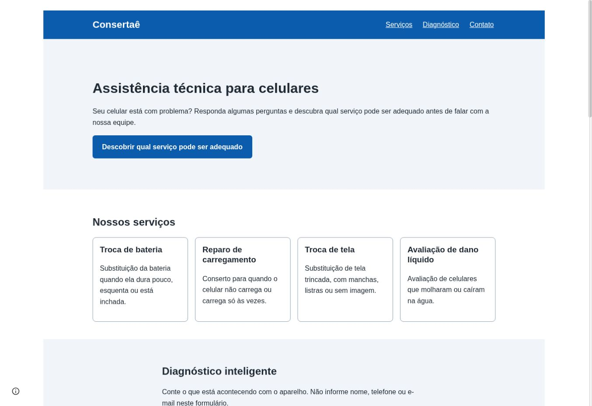
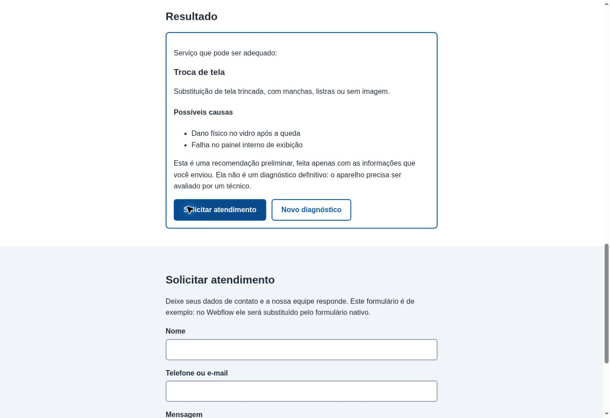
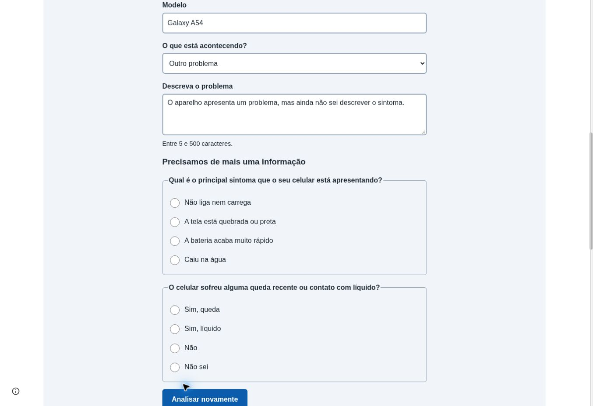

# Consertaê — Assistente Inteligente de Serviços

Projeto acadêmico da disciplina **Padrões Web para No Code e Low Code**, da UNIFECAF. O Consertaê apresenta serviços de assistência técnica de celulares e oferece uma **triagem inteligente**: a pessoa descreve um problema, responde a perguntas e recebe uma sugestão preliminar de serviço. **A recomendação não substitui a avaliação de um técnico.**

## Acesse a aplicação

- **Site publicado (Google Sites):** https://sites.google.com/view/consertae-unifecaf/in%C3%ADcio
- **Aplicação web hospedada na Vercel:** https://claude-unifecaf-frontend.vercel.app
- **API (endpoint POST):** https://consertae-api.vercel.app/api/diagnostico

O Google Sites é a plataforma visual utilizada para publicar a página de apresentação e **incorporar por URL** o aplicativo hospedado na Vercel. A interface interativa em HTML, CSS e JavaScript e a integração com a IA são executadas pela aplicação incorporada, **não pelo Google Sites**. O backend é uma função serverless separada na Vercel.

## Problema e proposta

Uma assistência técnica pode receber dúvidas repetidas sobre defeitos de celulares. O projeto propõe uma experiência digital acessível que apresenta serviços e auxilia o visitante a identificar **qual atendimento pode ser adequado**, sem prometer diagnóstico definitivo ou orçamento.

**Público-alvo:** pessoas que procuram assistência para celulares.

## Funcionalidades

- Apresentação dos serviços de **troca de bateria**, **reparo de carregamento**, **troca de tela** e **avaliação de dano líquido**.
- Formulário de triagem com marca, modelo, categoria do sintoma, descrição e perguntas objetivas.
- Consulta à API própria, que solicita ao Google Gemini uma recomendação restrita ao catálogo de serviços.
- Quando faltam informações, a IA pode retornar até duas perguntas adicionais; o fluxo admite até **duas rodadas** de análise.
- Exibição de serviço sugerido e possíveis causas, ou orientação para buscar avaliação quando não houver correspondência.
- Validação de campos e respostas, estados de carregamento e tratamento de falhas.
- Layout responsivo com recursos de acessibilidade.

**Limitação importante:** o formulário de contato da aplicação atual é **demonstrativo**. A mensagem “Pedido registrado (simulação local, nada foi enviado)” significa que nenhum pedido real foi encaminhado. Não se deve apresentá-lo como atendimento operacional.

## Arquitetura

```text
Google Sites (página visual publicada)
  └── Incorporação por URL / iframe
        └── Frontend na Vercel (HTML + CSS + JavaScript)
              └── fetch() POST /api/diagnostico
                    └── API serverless na Vercel
                          └── Google Gemini
                    ← JSON validado
              ← Resultado renderizado no navegador
```

**Justificativa das ferramentas:** Google Sites permite criar e publicar visualmente uma página sem contratar o recurso de código incorporado do Webflow. A Vercel hospeda o frontend personalizado e a API; HTML, CSS e JavaScript implementam a experiência interativa, enquanto o Gemini oferece a triagem por IA. A combinação demonstra integração entre uma plataforma visual e uma aplicação programada.

## Estrutura do repositório

| Caminho | Responsabilidade |
|---|---|
| `frontend/index.html` | Estrutura semântica: navegação, serviços, diagnóstico, resultado e contato |
| `frontend/style.css` | Estilos responsivos, layout mobile-first e estados visuais |
| `frontend/script.js` | Catálogo, perguntas, validações, requisições e atualização do DOM |
| `api/diagnostico.js` | Validação da entrada, comunicação com Gemini e normalização da resposta |
| `.env.example` | Nomes das variáveis de ambiente, sem segredos |
| `.gitignore` | Arquivos excluídos do versionamento |
| `README.md` | Documentação do projeto |

**Observação:** o código ainda contém comentários referentes a uma preparação anterior para Webflow. A publicação final descrita neste README utiliza **Google Sites com incorporação da aplicação da Vercel**; os comentários históricos não representam a arquitetura publicada.

## Personalização com padrões web

- **HTML:** formulários, rótulos, navegação por âncoras, seções e elementos semânticos.
- **CSS:** abordagem mobile-first, cartões em grade adaptável, cores e estilos de foco visível; estilos isolados sob `#consertae-app`.
- **JavaScript:** construção dinâmica das perguntas e cartões, manipulação do DOM, validação, controle de duas rodadas, `fetch()` e tratamento de respostas e erros.
- **Acessibilidade:** associação de rótulos a campos, link para pular ao diagnóstico, estados de erro com `role="alert"`, carregamento com `role="status"` e indicadores de foco. Esses recursos não substituem uma auditoria completa de acessibilidade.

## Fluxo da API

O frontend envia um JSON sem campos de identificação pessoal:

```json
{
  "aparelho": { "marca": "Samsung", "modelo": "Galaxy A54" },
  "problema": { "categoria": "carregamento", "descricao": "Não está carregando" },
  "respostas": [
    { "pergunta": "Você tentou outro cabo ou carregador?", "resposta": "Sim" }
  ],
  "rodada": 1
}
```

Respostas possíveis:

| `status` | Significado |
|---|---|
| `ok` | Serviço do catálogo e lista de possíveis causas |
| `insufficient_info` | Perguntas adicionais, apenas na primeira rodada |
| `no_match` | Nenhum serviço disponível corresponde ao problema |
| `error` | Erro de validação, integração ou processamento |

Na segunda rodada, `insufficient_info` não é permitido. A API valida campos de entrada, rejeita padrões de e-mail e sequências longas de números e valida o formato da resposta do Gemini. **Isso reduz riscos, mas não garante detecção de todos os dados pessoais**: o usuário deve evitar inserir informações sensíveis na descrição.

## Configuração e execução para desenvolvimento

**Requisitos:** ambiente com Node.js e Vercel CLI para a API; navegador para o frontend estático.

1. Clone o repositório e entre na pasta do projeto.
2. Crie um arquivo `.env` local com base em `.env.example`; não envie segredos ao GitHub.
3. Configure na Vercel a variável `GEMINI_API_KEY` e, se desejado, `GEMINI_MODEL` e `ALLOWED_ORIGINS`.
4. Para testar o frontend estático, execute na pasta `frontend`: `python3 -m http.server 8000` e abra `http://localhost:8000`. O `API_URL` de `frontend/script.js` aponta atualmente para a API publicada.
5. Para testar a API localmente, use `npx vercel dev` na raiz, com as variáveis configuradas, e ajuste temporariamente o `API_URL` do frontend para o endpoint local. Restaure a URL de produção antes de publicar.

### Variáveis de ambiente

| Variável | Uso |
|---|---|
| `GEMINI_API_KEY` | Obrigatória; chave secreta usada somente no backend |
| `GEMINI_MODEL` | Opcional; o código usa `gemini-2.5-flash` quando não configurada |
| `ALLOWED_ORIGINS` | Opcional; lista de origens permitidas, separadas por vírgula; ausente/vazia, o código responde com `*` |

O modelo efetivo da implantação pode ser diferente do padrão do código se `GEMINI_MODEL` estiver configurada no painel da Vercel. Não inclua valores secretos em capturas de tela.

## Como testar a aplicação publicada

1. Acesse o **link do Google Sites** acima.
2. Navegue até o Consertaê incorporado e escolha **Diagnóstico**.
3. Informe marca, modelo, sintoma e descrição; responda às perguntas exibidas.
4. Clique em **Analisar** e confira a recomendação preliminar, ou responda às perguntas adicionais quando solicitadas.
5. Experimente **Novo diagnóstico**. O responsável pelo projeto relatou teste bem-sucedido em celular; recomenda-se repetir a verificação em outros dispositivos e registrar captura de tela.
6. Observe que o formulário de contato **não envia mensagens reais**.

A incorporação pode apresentar barras de rolagem internas dependendo do tamanho configurado no Google Sites. O frontend também pode ser acessado diretamente pelo endereço da Vercel.

**Modo simulação para desenvolvimento:** se `API_URL` for definida como uma string vazia em `frontend/script.js`, o frontend utiliza respostas fictícias e exibe aviso. Esse **não** é o modo configurado atualmente no código da branch `main`.

## Evidências visuais do funcionamento

As capturas abaixo foram realizadas durante a execução da aplicação e mostram etapas reais da experiência do Consertaê.

### 1. Página inicial e apresentação dos serviços



*Visão inicial da aplicação publicada, com a apresentação dos serviços de assistência técnica.*

### 2. Resultado do diagnóstico inteligente



*Exemplo de resultado da triagem inteligente, apresentado após a análise das informações fornecidas.*

### 3. Perguntas adicionais para continuidade do diagnóstico



*Quando as informações são insuficientes, a IA solicita esclarecimentos para orientar a recomendação preliminar.*

Essas imagens documentam o funcionamento observado em testes, mas não representam diagnóstico técnico definitivo. O responsável também confirmou que testou a aplicação em celular e que ela funcionou normalmente; esse teste móvel foi relatado, não ilustrado pelas três capturas acima.

## Apresentação acadêmica

Além do README e das capturas reais acima, o enunciado solicita **documento teórico** (problema, público, ferramentas, personalização web, IA, responsividade, acessibilidade, limitações e aprendizados) e **vídeo pitch de até quatro minutos** com demonstração da aplicação. O vídeo foi gravado e publicado no YouTube; o responsável confirmou que sua duração está dentro do limite exigido.

### Vídeo pitch — Demonstração do Consertaê

**[Assistir à apresentação acadêmica no YouTube](https://youtu.be/SCC019fBFjA)**

A gravação apresenta o projeto, a interface, o diagnóstico inteligente e as tecnologias utilizadas. Para conferir o acesso pelo avaliador, recomenda-se abrir o link em uma janela anônima.

## Limitações e próximos passos

- A IA oferece **triagem preliminar**, não laudo técnico, garantia de reparo ou preço.
- O contato é apenas simulado; um fluxo real exigiria integração de envio e tratamento adequado de dados pessoais.
- A aplicação incorporada depende da disponibilidade do Google Sites, da Vercel e do serviço Gemini.
- A experiência de incorporação e a acessibilidade devem ser verificadas em diferentes navegadores e dispositivos.
- A página visual no Google Sites e o código-fonte estão em plataformas distintas; o uso de código personalizado acontece no aplicativo incorporado.

---

**Projeto acadêmico — UNIFECAF | Padrões Web para No Code e Low Code.**

### Atualizações de revisão (15/10/2026)

- O texto visível do formulário de contato em `frontend/index.html` foi atualizado para deixar explícito que o envio é uma simulação, sem referência à futura integração com Webflow (commit `852f41f`). A alteração na aplicação pública depende do deploy correspondente.
- O responsável pelo projeto confirmou que testou a aplicação em um celular e que ela funcionou normalmente. Esse relato não substitui capturas móveis ou testes de acessibilidade.
- O relatório acadêmico produzido no Work contém três capturas reais (catálogo incorporado ao Google Sites, resultado de triagem e perguntas adicionais). As três capturas reais foram posteriormente adicionadas em `docs/imagens/Evidencias_Consertae_Astra/` e incorporadas à seção de evidências visuais deste README.
